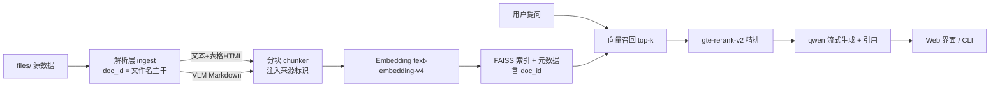

## 用户需求

在空项目 `RAG多模态` 中从零搭建一个多模态 RAG 知识库，`files/` 目录（26 个 PDF + 67 张图片，含课表、财报表格、OCR 对比图等信息图）作为唯一源数据；大模型统一使用阿里云百炼，API Key 与模型名称通过 `.env` 配置且可随时替换；同时提供可复用的核心模块、命令行工具与 Web 界面。

**追加需求**：分块必须携带标识（`doc_id`），标识值取自 `files/` 数据源的文件名（`001.pdf` → `001`，`010.png` → `010`），并贯穿分块、索引、检索、引用与前端展示全链路。

## 产品概述

用户可一键把 `files/` 中全部 PDF 与图片解析入库，随后用自然语言提问，系统给出基于文档内容的回答并标注引用来源（文件标识 + 文件名 + 页码 + 类型），表格以 HTML 结构保留，图片可回看原图。

## 核心功能

- **多模态解析入库**：PDF 优先提取文本层；表格区域识别后转为 HTML 表格；无文本层的扫描页渲染为图片交给视觉模型识别；独立图片（PNG/JPG/WebP）由视觉模型输出结构化 Markdown，表格同样转 HTML。
- **来源标识（doc_id）**：每个文件解析时即确定唯一标识 `doc_id = 文件名主干`（去扩展名，如 `001`、`077`），该标识写入每个 chunk 的元数据，并在分块文本前缀、索引元数据、检索结果、API 响应、前端引用卡片中保持一致；同一文件的所有分块共享同一 `doc_id`，可用于按文档聚合、过滤与溯源。
- **知识库构建**：文本分块、向量化并写入本地向量索引，支持全量重建与增量更新（仅处理新增/改动文件），解析结果缓存避免重复调用视觉模型。
- **检索问答**：问题向量召回候选片段，经重排序精排后交给对话模型生成答案，答案中标注 [1][2] 引用编号；资料不足时明确说明而不是编造。
- **Web 界面**：单页聊天界面，流式输出、引用来源卡片（可点击查看原图/文件标识与页码）、知识库索引状态与一键重建索引。
- **命令行工具**：支持构建/重建索引、查看库统计（含按 doc_id 分组的分块数）、单次提问与交互式多轮问答，便于快速验证。
- **可配置性**：对话模型、视觉模型、向量模型、重排序模型及温度、召回数量、分块大小、并发度等参数全部集中在 `.env`，无需改代码即可切换模型。

## 视觉与交互效果

浅色简洁学术风格，顶部导航显示知识库状态徽章，左侧为文件与索引概览，中部为对话流，回答下方以卡片形式列出引用来源（doc_id 徽章 + 文件名 + 页码 + 文本/表格/图片标签），图片引用带缩略图预览；输入区支持回车发送、加载中流式打字效果与停止生成。

## 技术选型

- 后端：Python 3.11（已装于 `/Users/chenyun/.pyenv/shims/python3`）+ FastAPI + Uvicorn
- 大模型：阿里云百炼 OpenAI 兼容模式（`https://dashscope.aliyuncs.com/compatible-mode/v1`），`openai` SDK 调用对话（qwen-plus 等）与向量模型（text-embedding-v4）
- 视觉理解：百炼 `qwen-vl-max`（OpenAI 兼容 `image_url` 传 base64 data URL）
- 重排序：`dashscope` SDK 的 `TextReRank`（gte-rerank-v2）
- PDF 解析：`pdfplumber`（文本 + `find_tables()` 表格检测）+ `pypdfium2`（扫描页渲染，已安装）
- 向量库：`faiss-cpu`（IndexFlatIP + L2 归一化，等价余弦相似度）
- 配置：`pydantic-settings` + `python-dotenv`（`.env` 单文件配置）
- 前端：原生 HTML/CSS/JS 单页（由 FastAPI 静态挂载，免 Node 构建）

环境核对结论：`dashscope 1.25.5 / faiss-cpu 1.16.0 / fastapi 0.157.0 / pdfplumber 0.11.10 / pypdfium2 5.15.2 / openai 1.109.1 / numpy 1.26.4 / pillow 13.0.0 / pydantic-settings 2.15.0` 均已安装，仅需补充少量依赖声明，无需虚拟环境重建。

## 实现策略

**分层架构**：`ingest`（解析与缓存）→ `store`（分块向量与索引）→ `rag`（检索与生成）为可复用核心；`api`（FastAPI）与 `cli` 只做编排，保证"模块 + CLI + Web"三处共用同一套逻辑。

**来源标识规则（doc_id）**：

- 由文件名主干生成，`Path(name).stem`，例如 `001.pdf → 001`、`027.webp → 027`；同时保留完整 `file_name`。
- 单一入口函数 `build_doc_id(file_path)` 放在 `app/ingest/pipeline.py`（或 `app/utils.py`），全项目只此一处生成，避免大小写/扩展名不一致。
- 分块文本头部注入 `【来源标识：001｜001.pdf 第2页｜表格】` 形式的上下文头，使标识不仅能按元数据过滤，也参与向量语义（提问"001 里讲了什么"可直接命中）。
- 元数据字段固定为 `{doc_id, file_name, page, type, image_path, chunk_index}`，随 `chunks.jsonl` 落盘，检索结果与 API 响应原样透出。

**PDF 混合解析（关键决策）**：实测 26 个 PDF 中 22 个有文本层、4 个扫描件（002–005.pdf 提取字符数为 0），因此采用"文本层优先 + 扫描页兜底"：

1. `page.extract_text()` 取正文；同时 `page.find_tables()` 定位表格，用 `page.outside_bbox(bbox)` 剔除表格区域文字，避免表格内容被重复且乱序地切成正文片段。
2. 每个表格 `table.extract()` 的结果拼装成 `<table><thead>…<tbody>…</tbody></table>` 作为独立分块，块首附加"【来源标识：006｜006.pdf 第1页｜表格1/8，共R行C列】"说明文本以便检索命中。
3. 页面可提取字符数低于阈值（20 字符/页）判定为扫描页，用 `pypdfium2` 以约 2 倍缩放渲染为 JPEG 后送 VLM，prompt 要求输出结构化 Markdown、表格转 `<table>` HTML、不臆造数值。

**图片解析**：统一转 RGB（WebP 带透明通道补白底）、长边压缩到 1600px、JPEG q85 后再 base64，控制 token 成本；prompt 约束"先一句话概述，再结构化要点，表格必须转 HTML 表格，保留原始数值与编号"。图片内容实测（010.png 日程表、027.webp 能力对比表）均为高信息密度排版图，故要求结构化输出而非纯描述。解析结果的每个分块同样带 `doc_id` 与 `image_path`。

**分块策略**：文本按段落递归切分（默认 500 字符、重叠 80），每块前缀注入"【来源标识：doc_id｜文件名 第X页｜类型】"上下文头提升召回与溯源；表格单块保存（超 2000 字符按行切分并重复表头 `<thead>`，子块沿用同一 `doc_id` 并标注行范围）；图片按 VLM 输出的 Markdown 标题切分，每块记录 `image_path` 供前端预览。`chunk_id` 采用 `{doc_id}_{page}_{type}_{序号}` 格式，保证可读且全局唯一。

**索引与增量**：FAISS `IndexFlatIP` + 向量 L2 归一化；`data/index/` 下持久化 `index.faiss`、`vectors.npy`、`chunks.jsonl`（与向量行号严格对齐，每行含 doc_id 等元数据）、`manifest.json`（文件 mtime+size 指纹、doc_id 列表、模型名、维度、chunker 版本）。新增/变更文件追加向量；检测到文件删除或模型/维度变更则自动全量重建（Flat 索引不支持删除，这是最小代价方案）。

**检索生成链路**：查询向量化 → 向量召回 top-k（默认 20）→ `gte-rerank-v2` 精排取 top-n（默认 5）→ 按 `doc_id + page` 去重、按 `max_context_chars`（默认 8000）截断 → 拼 `[1]..[n]` 上下文（每段带来源标识）→ 流式生成。系统提示强约束"仅依据资料作答、逐句标注引用编号、资料不足需说明"，并要求在提到资料时带上来源标识。多轮对话保留最近 3 轮历史，历史不参与向量化。

**成本与性能**：全库约 74 次 VLM 调用（67 图 + 4 扫描页）、约 700–900 个分块、80 次左右批量 embedding（v4 单请求上限 10 条）；VLM 用线程池并发（默认 4）+ 指数退避重试，解析结果按文件哈希缓存到 `data/parsed/`，重建索引不重复计费。问答链路耗时为一次 embedding + 一次 rerank + 一次 LLM 流式，均为单次网络往返，无 N+1 问题。

## 配置项（.env）

`DASHSCOPE_API_KEY`、`DASHSCOPE_BASE_URL`、`LLM_MODEL`、`VLM_MODEL`、`EMBED_MODEL`、`EMBED_DIM`、`RERANK_MODEL`、`LLM_TEMPERATURE`、`TOP_K_VECTOR`、`TOP_K_RERANK`、`CHUNK_SIZE`、`CHUNK_OVERLAP`、`MAX_CONTEXT_CHARS`、`VLM_CONCURRENCY`、`EMBED_BATCH_SIZE`、`FILES_DIR`、`DATA_DIR`。缺 key 时启动即给出明确中文提示，不静默失败。

## 架构设计



## 目录结构

```
RAG多模态/
├── requirements.txt                 # [NEW] 依赖清单（含已装版本约束，说明无需重装）
├── .env.example                     # [NEW] 全部可配置项与注释，复制为 .env 后填 key
├── README.md                        # [NEW] 安装、配置、建库、Web/CLI 使用与常见问题
├── app/
│   ├── __init__.py                  # [NEW] 包初始化
│   ├── config.py                    # [NEW] pydantic-settings 读取 .env；暴露 llm/vlm/embed/rerank 四角色模型与检索参数；校验 API Key 并给出中文提示
│   ├── clients/
│   │   ├── __init__.py              # [NEW]
│   │   ├── llm.py                   # [NEW] 单例 OpenAI 兼容客户端：chat_stream()、complete()、vision_describe(image_bytes, prompt)、embed_texts(list[str]) 批量+重试+指数退避
│   │   └── rerank.py                # [NEW] dashscope TextReRank 封装：rerank(query, docs, top_n)，失败时降级为原顺序并记日志
│   ├── ingest/
│   │   ├── __init__.py              # [NEW]
│   │   ├── pdf_parser.py            # [NEW] pdfplumber 逐页解析：正文、find_tables→HTML、outside_bbox 去重、扫描页 pypdfium2 渲染+VLM 兜底；输出统一 PageDoc 结构（含 doc_id）
│   │   ├── image_parser.py          # [NEW] 图片预处理（RGB/缩放/JPEG）+ VLM 结构化解析（表格转 HTML），输出带 doc_id 的块
│   │   ├── chunker.py               # [NEW] 段落递归分块、表格行切分继承表头、来源标识上下文头注入、chunk_id 生成（doc_id_page_type_序号）
│   │   └── pipeline.py              # [NEW] build_doc_id()、遍历 files/、并发调度、data/parsed 缓存（文件哈希）、增量判定、调用 store 建索引、tqdm 进度回调
│   ├── store/
│   │   ├── __init__.py              # [NEW]
│   │   └── faiss_store.py           # [NEW] FAISS 索引的构建/加载/保存；chunks.jsonl 与行号对齐且携带 doc_id；manifest 指纹比对；全量重建与增量追加；按 doc_id 过滤的相似度检索
│   ├── rag/
│   │   ├── __init__.py              # [NEW]
│   │   ├── retriever.py             # [NEW] 查询向量化→FAISS 召回→rerank 精排→按 doc_id+页去重→上下文拼接与引用编号
│   │   └── qa.py                    # [NEW] 系统提示词、多轮历史裁剪、流式生成、引用结构组装（doc_id/文件名/类型/页码/图片路径）
│   ├── api.py                       # [NEW] FastAPI：/api/chat(SSE 流式)、/api/ingest(后台任务+进度)、/api/status、/api/files/{name}（防目录穿越）、/api/chunks?doc_id=xxx、静态页面挂载
│   ├── cli.py                       # [NEW] argparse 子命令：ingest(--rebuild)、ask(单次/交互，支持 --doc 按标识过滤)、stats(按 doc_id 统计)
│   └── web/
│       ├── index.html               # [NEW] 聊天页结构：顶栏、知识库侧栏、对话流、引用卡片、输入区
│       ├── style.css                # [NEW] 设计系统变量、玻璃拟态卡片、流式打字、响应式布局
│       └── app.js                   # [NEW] SSE 流式渲染、引用卡片（含 doc_id 徽章）与图片预览、索引状态轮询、重建索引交互
├── data/
│   ├── parsed/                      # [NEW] 解析缓存（按文件哈希命名，运行期生成）
│   └── index/                       # [NEW] index.faiss / vectors.npy / chunks.jsonl / manifest.json（运行期生成）
└── files/                           # 源数据（已存在，不改动）
```

## 实施注意事项

- 复用已装依赖，`requirements.txt` 只声明用途与最低版本，避免环境重装；PDF 渲染统一走 `pypdfium2`，不引入 PyMuPDF。
- `doc_id` 只在一处生成（`build_doc_id`），任何需要来源标识的地方都调用它或直接读取 chunk 元数据，禁止在前端/CLI 二次截取文件名。
- VLM 与 Embedding 调用必须带重试与并发上限，避免百炼 QPS 限流导致整库构建中断；解析缓存命中时零 API 消耗。
- 引用元数据结构（`doc_id`、文件、页码、类型 text/table/image、图片路径、chunk_id）在 `chunker → store → retriever → api → 前端` 全链路保持一致，避免前端拿不到图片路径或标识。
- `/api/files/{name}` 只允许访问 `files/` 下的白名单文件名（路径规范化校验），防止目录穿越。
- 日志使用标准 `logging`，记录文件级耗时与失败原因，不打印 API Key 与图片 base64。
- 改动仅限新增文件，不触碰 `files/` 源数据。

## 设计风格

浅色学术科技风：以冷白底 + 靛蓝紫渐变为主视觉，卡片采用半透明玻璃拟态与极轻描边，弱阴影营造层次但不喧闹。整体信息密度适中，强调"检索—引用"的可信感，语气克制专业。

## 页面规划（单页应用）

仅一屏，采用桌面三栏结构，自上而下分为：

1. **顶部导航栏**：左侧产品名与副标题，中部知识库状态徽章（索引分块数、文件数、模型名），右侧"重建索引"按钮与主题色呼吸光点。
2. **左侧知识库侧栏**：源数据概览卡片、文件类型分布（PDF/图片/表格统计）、最近入库文件列表（每项显示 doc_id 徽章与文件名）；构建索引时显示并发进度条与逐文件完成动效。
3. **中部对话区**：欢迎态给出 3 个示例问题胶囊；消息气泡区分用户（右侧靛蓝渐变）与助手（左侧白卡片），流式打字光标、Markdown 渲染、表格按 HTML 原样展示且横向可滚动。
4. **引用来源区**：每个回答下方横向卡片列表，显示 doc_id 徽章、文件图标、文件名、页码、类型标签（文本/表格/图片），点击展开片段原文；图片类引用显示缩略图，点击灯箱大图。
5. **底部输入区**：自适应高度多行输入、发送/停止按钮、回车发送、快捷键提示与"仅基于知识库作答"说明条。

## 交互与响应式

消息进入上浮淡入，引用卡片逐张延迟出现，按钮 hover 有轻微位移与辉光，索引构建时有流动光泽进度条。宽度小于 1024px 时侧栏折叠为顶部抽屉，对话区占满，引用卡片改为纵向列表。全站支持深浅两套背景变量的平滑过渡但默认浅色。

## 使用的 Agent 扩展

### Skill

- **pdf**
- Purpose: 在实现 PDF 解析器时提供 PDF 文本/表格提取与扫描件 OCR 处理的规范做法，确保 pdfplumber 表格检测、边界裁剪与扫描页渲染方案正确落地
- Expected outcome: 产出可稳定解析 files/ 下 22 个文本型 PDF（含 077.pdf 的 58 个表格）与 4 个扫描件的解析模块，表格以 HTML 结构入库，且每个分块携带来源于文件名的 doc_id