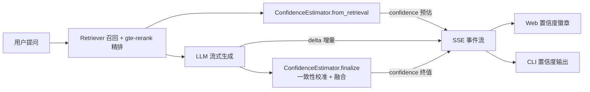

## Product Overview

在现有「多模态 RAG 知识库」（Web 界面 + CLI）中，为每条 AI 回答增加 0-1 的置信度标识：检索完成先给出初判（标注"预估"），答案生成结束后结合大模型的一致性评估校准为终值，让用户一眼判断该答案的可信程度。

## Core Features

- **两段式置信度**：检索完成即算出 0-1 初判并随流下发，首字延迟不变；回答结束后给出终值。
- **融合评分**：由 top1 精排分、分数间隔、来源覆盖即时计算基础分；再由大模型依据"答案与引用资料的一致性"给出 0-1 校准分，按权重融合；精排不可用时按向量分估算并标记降级；答案中出现"资料不足/无法回答"时封顶为低分。
- **Web 展示**：AI 回答底部显示「置信度 0.82 · 高」胶囊 + 迷你进度条；悬停或聚焦展开构成明细（精排分 / 分数间隔 / 来源覆盖 / 一致性 / 引用命中）；低置信度附一行"资料可能不足，请核实引用原文"；生成中显示"预估"虚线态，用户中断后保留预估不再变更为终值。
- **CLI 展示**：答案下方打印「置信度 0.82 · 高（检索 0.70 / 一致性 0.88）」，低置信度追加提醒行；单次提问与交互模式一致。
- **事件与字段**：流式新增 confidence 事件（预估、终值各一次），done 事件携带最终值；`ask()` 返回值新增 confidence；现有 `/api/chat` 请求格式不变。
- **可配置**：置信度总开关、大模型校准开关、等级阈值（默认高 ≥0.75、低 <0.45）、精排分归一化区间、融合权重均写入 `.env`。

## 视觉要求

胶囊、进度条与构成浮层沿用现有 indigo/violet 玻璃拟态风格；高置信度用绿色、中置信度用琥珀色、低置信度用红色作点缀，不引入新字体与新框架。

## Tech Stack

- 后端：沿用 Python 3.11 + pydantic-settings + FastAPI（SSE 流式），不新增第三方依赖
- 前端：沿用原生 HTML/CSS/JS（`app/web/`），复用现有设计令牌与动画
- 模型：复用现有 `LLMClient.complete()`（qwen-plus，自带重试），不新建客户端

## Implementation Approach

### 1. 新增置信度计算模块

新增 `app/rag/confidence.py`，实现 `ConfidenceEstimator`，职责单一（评分策略集中于此，便于后续调参）：

- **归一化**：`norm(x, low, high)` 线性裁剪到 0~1。精排分经验区间取 `0.10~0.65`（gte-rerank-v2 实测相关片段约 0.48、弱相关 0.11~0.18），向量分区间取 `0.30~0.75`，均可配。
- **检索分**（无额外调用、微秒级）：`retrieval = 0.60*rel_top + 0.22*margin + 0.18*coverage`
- `rel_top`：top1 精排分归一化；精排全为 None 时降级用 `vector_score` 归一化并置 `degraded=true`
- `margin`：`min((top1 - top3)/0.25, 1)`，命中不足 3 条时用 top1-top2
- `coverage`：`0.6*min(命中数/4,1) + 0.4*min(来源文件数/2,1)`
- **一致性校准**（生成结束后一次轻量调用）：`llm.complete()` 输入「问题 + 答案（截断 2000 字）+ 前 3 条引用摘要（各 400 字）」，要求只输出 `{"consistency":0-1,"reason":"..."}`；温度 0、`max_tokens=200`；解析时用正则取首个 `{...}` 再 `json.loads`，字段强转 float 并裁剪。异常、超时、非法 JSON 一律降级为纯检索分（`method=retrieval`、`llm=null`），不抛错、不影响答案。
- **终值融合**：`score = w*retrieval + (1-w)*consistency`（`w` 默认 0.55）；随后乘引用命中修正 `0.85 + 0.15*citation_hit`（答案中的 `[n]` 是否命中真实引用编号）；若答案含"资料不足/无法回答/未检索到"等症状则封顶 0.30；最终 clamp 到 0~1、保留两位小数。
- **等级与提示**：`high ≥ CONFIDENCE_HIGH`、`low < CONFIDENCE_LOW`、其余 medium；低分统一返回 `hint="资料可能不足，请核实引用原文"`。文案与阈值只在后端定义，前端只渲染，避免多端不一致。

### 2. 流式事件协议扩展

`RAGChat.ask_stream` 事件顺序改为：`sources` → `confidence(stage=retrieval)` → `delta...` → `confidence(stage=final)` → `done(confidence=最终值)`；无命中时返回 `score=0` 的 confidence 后直接 `done`；生成异常时只发 `error`，前端保留预估态。`api.py` 的 SSE 已做通用 `json.dumps` 透传，无需改接口签名。`ask()` 收集 confidence，返回 `{answer, sources, confidence, error}`。

### 3. 前端徽章

`appendMessage` 为 assistant 气泡预留 `.confidence` 容器（位于 markdown 与 citations 之间）；新增 `updateConfidence(message, conf)`：

- `stage=retrieval`：胶囊带"预估"角标、虚线描边、进度条动画从 0 到目标值
- `stage=final`：去掉"预估"、实线描边、数值与颜色平滑过渡
- 构成浮层用 CSS `:hover` / `:focus-within` 展开（胶囊 `tabindex=0`），列出各项分值与 `reason`
- 低置信度追加 `.confidence-hint` 提示行；`error` 时隐藏徽章；`AbortError` 分支不改写徽章

### 4. CLI 输出

新增 `_print_confidence(conf)`，在答案之后、引用来源之前打印：
`置信度 0.82 · 高（检索 0.70 / 一致性 0.88）`，低置信度再打印提醒行；单次与交互模式共用。

### 5. 配置项

`Settings` 新增：`confidence_enabled`(True)、`confidence_llm_enabled`(True)、`confidence_high`(0.75)、`confidence_low`(0.45)、`confidence_rerank_low`(0.10)、`confidence_rerank_high`(0.65)、`confidence_vector_low`(0.30)、`confidence_vector_high`(0.75)、`confidence_retrieval_weight`(0.55)。同步写入 `.env.example` 与 README 配置表。

### 性能与可靠性

- 首字延迟：预估分由已召回的 hits 直接计算，无网络调用。
- 额外成本：每题一次约 500~900 token 的校准调用，完成于答案之后；`CONFIDENCE_LLM_ENABLED=false` 可整体关闭。
- 索引零影响：不涉及分块与向量，无需重建（当前 397 块 / 92 文件保持不变）。
- 失败不阻断：校准异常全部走降级分支，日志 `logger.info` 记录分值构成（不记录答案全文）。

## Architecture Design



## Implementation Notes

- 复用 `RAGChat.llm` 实例，避免新建连接；校准调用必须包在 `try/except` 内，任何异常只降级不改流程。
- 计算结果只包含分数、等级、构成与一句 reason，绝不回传分块原文，避免 SSE 体积膨胀。
- 现有 `readSSE` 已支持任意事件类型，仅需在 `sendMessage` 增加分支，不要重写流解析。
- `settings` 为单例，修改 `.env` 后需重启 uvicorn 生效。
- 不改动 `files/`、不触发 ingest；除置信度相关文件外不做无关重构。
- 前端新增样式追加到 `style.css` 的「引用卡片」区块之后，复用 `--green/--amber/--red/--indigo-*` 令牌与 `fadeUp` 动画。

## Directory Structure

```
app/
├── rag/
│   ├── confidence.py        # [NEW] 置信度评估器：检索分归一化、margin/coverage 计算、等级映射、低分提示；LLM 一致性校准与 JSON 解析；融合公式与降级策略。对外暴露 from_retrieval(hits)、finalize(question, answer, hits, base)、no_hit()，返回可直接序列化的 dict。
│   ├── qa.py                # [MODIFY] ask_stream 中调用估算器：检索后 yield confidence(stage=retrieval)，生成结束后 yield confidence(stage=final) 并在 done 中携带；无命中返回 0 分；ask() 新增 confidence 字段。
│   └── retriever.py         # [REFERENCE] 无需改动，复用 hits 中的 score/vector_score/doc_id/type 字段。
├── config.py               # [MODIFY] 新增 confidence_* 配置项（开关、阈值、归一化区间、融合权重），保持现有命名风格。
├── cli.py                  # [MODIFY] 新增 _print_confidence()，在答案后打印置信度与等级、括号内展示检索分/一致性，低分追加提醒；单次与交互模式均调用。
└── web/
    ├── app.js              # [MODIFY] appendMessage 预留 .confidence 容器；新增 updateConfidence() 渲染胶囊/进度条/构成浮层/低分提示；sendMessage 增加 confidence 与 done 分支处理；error 隐藏、abort 保留预估。
    └── style.css           # [MODIFY] 新增 .confidence 系列样式（胶囊、进度条、浮层、high/medium/low 配色、pending 虚线态、final 过渡动画、移动端适配）。
.env.example                 # [MODIFY] 新增置信度相关变量与注释（默认值、区间含义、关闭方式）。
README.md                    # [MODIFY] 功能特性新增"置信度标识"，配置表补充变量说明，快速开始示例展示 CLI 输出。
```

## Key Code Structures

```python
# app/rag/confidence.py
def from_retrieval(self, hits: list[dict]) -> dict:
    """hits 为空 -> 0 分；否则按精排分/margin/coverage 计算 base（含 degraded 标记）。"""

def finalize(self, question: str, answer: str, hits: list[dict], base: dict) -> dict:
    """一致性校准 + 融合 + 引用命中修正 + 低分封顶；失败时原样返回 base 并置 method='retrieval'。"""

# 下发给前端的结构（SSE confidence 事件 / done.confidence / ask()['confidence']）
{
    "score": 0.82, "percent": 82,
    "level": "high", "level_label": "高",
    "stage": "final",              # retrieval | final
    "method": "hybrid",            # retrieval | hybrid
    "degraded": False,
    "hint": None,                  # 低分时为提示文案
    "components": {
        "rerank_top": 0.48, "rerank_norm": 0.69, "margin": 0.60,
        "coverage": 0.75, "retrieval": 0.70,
        "consistency": 0.88, "citation_hit": 1.0
    },
    "reason": "答案数值与引用表格一致"
}
```